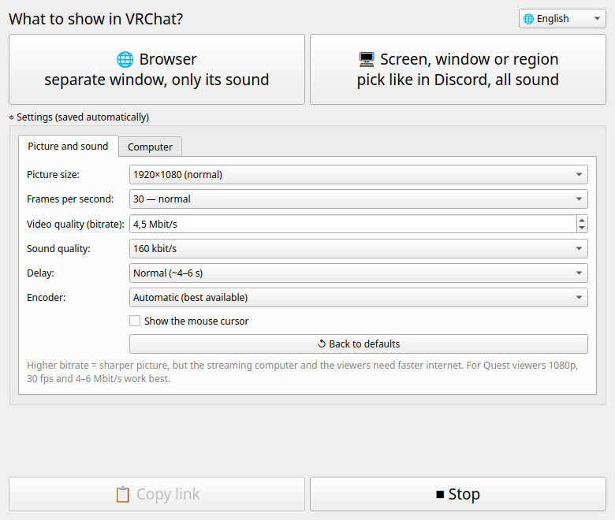
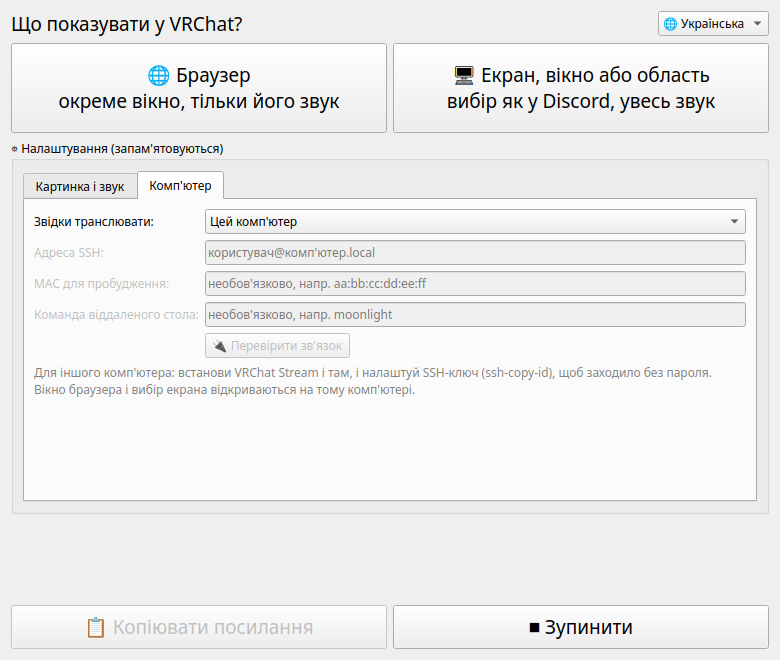

# VRChat Stream

> 🤖 **Generated by AI (Claude, Anthropic)** at the request of Lokinya, who set the requirements and tested it.
> 🤖 **Створено штучним інтелектом (Claude, Anthropic)** на прохання Lokinya, яка поставила задачу й перевірила результат.

**[English](#english) · [Українська](#українська)**



---

## English

Watch anything together in VRChat: a film from a site that VRChat's player can't open, a browser tab, a game, your whole screen or just part of it. VRChat Stream turns it into a link that works in a world's video player, on **PC and Quest**.

It works even behind a "grey" (CGNAT) or changing IP address. The link goes through Cloudflare's free quick tunnel, so you don't need to open any ports.

### Install (one command)

```bash
curl -fsSL https://raw.githubusercontent.com/lokinyauv-create/vrchat-stream/main/get.sh | bash
```

Then open **VRChat Stream** from the app menu.

Uninstall: `bash ~/.local/share/vrchat-stream/uninstall.sh`

### How to use

1. Pick what to show:
   - **🌐 Browser** opens a separate browser window. Only the sound of that window goes into the stream, so your Discord and notifications stay private.
   - **🖥 Screen, window or region** shows the usual "share screen" picker, like in Discord. All the computer's sound goes into the stream.
2. Wait until the link appears. It is copied automatically.
3. Paste it into the video player in VRChat (it needs *Allow Untrusted URLs* or a world player that accepts any link).

To stop the stream, close the window. You get a new link every time you start.

### Settings

- **Picture and sound:** picture size (720p / 1080p / 1440p), frames per second (24 / 30 / 60), video bitrate, sound quality, the encoder (NVIDIA, AMD/Intel VA-API or the processor), and the mouse cursor.
- **Delay:** choose between **minimal** (~3 s), **normal** (~4–6 s) or **stable** (~8–12 s, for bad internet). Some world players (e.g. ProTV) also have their own *low latency* switch.
- **Browser:** which browser opens in 🌐 mode — the computer's default browser, or Brave, Chrome, Chromium, Vivaldi, Edge, Firefox, LibreWolf or Zen (regular or Flatpak). Browsers that aren't installed are greyed out. Each has its own separate profile for the stream, so your logins in it stay between streams.
- **Computer:** stream from **this computer**, or from **another computer over SSH** (e.g. a second PC or a mini server, so your gaming PC stays free).
  - Optional: a MAC address to wake that computer up (Wake-on-LAN).
  - Optional: a command that opens your remote desktop app for it (e.g. `moonlight`).
  - **🔌 Test connection** checks that everything is ready.
- **Language:** the 🌐 switch in the top right corner (English / Українська).

### Requirements

- Linux with a **Wayland** desktop (tested on Fedora KDE Plasma 6).
- `python3` with PySide6 (the installer tries to get it), `ffmpeg`, [`cloudflared`](https://developers.cloudflare.com/cloudflare-one/connections/connect-networks/downloads/), `Xwayland`, a browser (Chromium-based or Firefox-based), and PipeWire.
- For "Screen, window or region": `python3-dbus`, `python3-gobject` and GStreamer with its PipeWire plugin.
- The installer lists whatever is missing, with commands for Fedora, Ubuntu and Arch.
- For another computer: install VRChat Stream there too, and set up an SSH key (`ssh-copy-id user@computer`).

### How it works

1. The capture uses its own Xwayland window (Browser mode) or the desktop's screen-sharing portal (Screen mode).
2. `ffmpeg` / GStreamer encode it into H.264 + AAC HLS in 1–2 s pieces.
3. A small local web server serves the pieces, and `cloudflared` publishes it as a `https://….trycloudflare.com/index.m3u8` link.

If the shared window changes size or goes fullscreen, the stream keeps going: the last picture is repeated while the capture reconnects.

---

## Українська

Дивіться що завгодно разом у VRChat: фільм із сайту, який плеєр VRChat не відкриває, вкладку браузера, гру, весь екран або лише його частину. Трансляція у VRChat робить із цього посилання, яке працює в плеєрі світу **на ПК і на Quest**.

Працює навіть із «сірою» (CGNAT) або змінною IP-адресою. Посилання йде через безкоштовний швидкий тунель Cloudflare, тож відкривати порти не треба.



### Встановити (одна команда)

```bash
curl -fsSL https://raw.githubusercontent.com/lokinyauv-create/vrchat-stream/main/get.sh | bash
```

Потім відкрий у меню програм **«Трансляція у VRChat»**. Мова перемикається кнопкою 🌐 у правому верхньому куті.

Видалити: `bash ~/.local/share/vrchat-stream/uninstall.sh`

### Як користуватися

1. Вибери, що показувати:
   - **🌐 Браузер** відкриває окреме вікно браузера. У трансляцію йде тільки звук цього вікна, тож Discord і сповіщення ніхто не почує.
   - **🖥 Екран, вікно або область** показує звичайне вікно «поділитися екраном», як у Discord. У трансляцію йде весь звук комп'ютера.
2. Зачекай, поки з'явиться посилання. Воно копіюється саме.
3. Встав його у плеєр у VRChat (потрібно ввімкнути *Allow Untrusted URLs* або плеєр світу, що приймає будь-які посилання).

Щоб зупинити трансляцію, закрий вікно. Щоразу при запуску буде нове посилання.

### Налаштування

- **Картинка і звук:** розмір картинки (720p / 1080p / 1440p), кадри на секунду (24 / 30 / 60), бітрейт відео, якість звуку, кодування (NVIDIA, AMD/Intel VA-API або процесор) і курсор миші.
- **Затримка:** можна вибрати **мінімальну** (~3 с), **звичайну** (~4–6 с) або **стабільну** (~8–12 с, для поганого інтернету). Деякі плеєри у світах (наприклад, ProTV) мають ще й власну кнопку *low latency*.
- **Браузер:** який браузер відкривається в режимі 🌐: браузер за замовчуванням або Brave, Chrome, Chromium, Vivaldi, Edge, Firefox, LibreWolf чи Zen (звичайний або Flatpak). Невстановлені браузери сірі. Кожен має свій окремий профіль для трансляції, тож входи на сайти в ньому зберігаються.
- **Комп'ютер:** транслювати з **цього комп'ютера** або з **іншого через SSH** (наприклад, з другого ПК чи міні-сервера, щоб ігровий ПК був вільний).
  - Необов'язково: MAC-адреса, щоб будити той комп'ютер (Wake-on-LAN).
  - Необов'язково: команда, яка відкриває віддалений стіл (наприклад, `moonlight`).
  - Кнопка **🔌 Перевірити зв'язок** показує, чи все готово.

### Що потрібно

- Linux зі стільницею **Wayland** (перевірено на Fedora KDE Plasma 6).
- `python3` і PySide6 (встановлювач спробує поставити його сам).
- `ffmpeg`, [`cloudflared`](https://developers.cloudflare.com/cloudflare-one/connections/connect-networks/downloads/) і `Xwayland`.
- Браузер (на основі Chromium або Firefox) і PipeWire.
- Для режиму «Екран, вікно або область»: `python3-dbus`, `python3-gobject` і GStreamer з плагіном PipeWire.
- Встановлювач покаже, чого бракує, і дасть команди для Fedora, Ubuntu та Arch.
- Для іншого комп'ютера: встанови Трансляцію у VRChat і там, і налаштуй SSH-ключ (`ssh-copy-id користувач@комп'ютер`).

---

Apache-2.0 · © 2026 Lokinya. Not affiliated with VRChat Inc. or Cloudflare, Inc.
